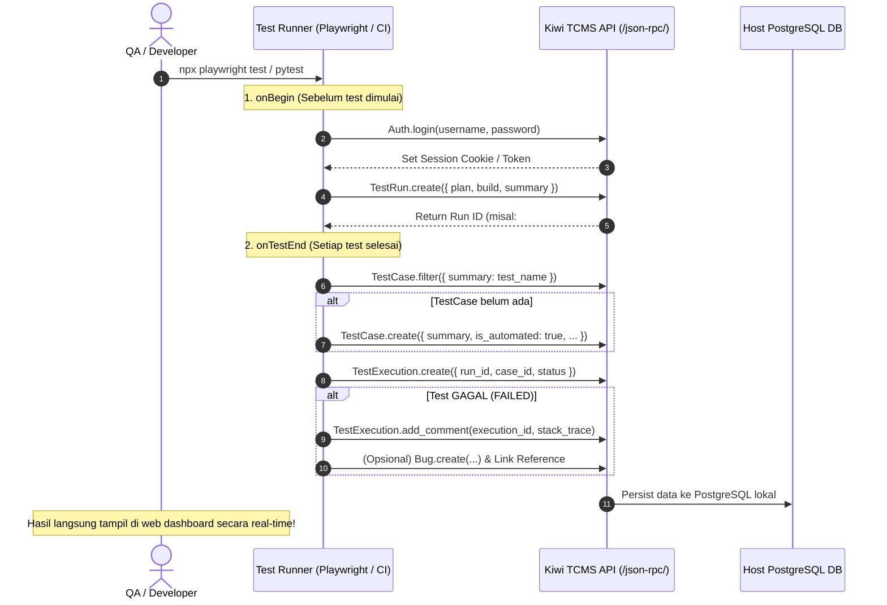

# 🤖 Panduan Integrasi Test Automation ke Kiwi TCMS via API

Dokumentasi ini menjelaskan cara menghubungkan framework test automation (seperti **Playwright**, **pytest**, **Robot Framework**, atau script custom) agar secara otomatis mencatat dan memperbarui **Test Case**, **Test Run**, **Hasil Eksekusi (Passed/Failed)**, serta **Log Error / Bug** langsung ke dalam database Kiwi TCMS.

---

## 📑 Daftar Isi
1. [Arsitektur & Alur Kerja](#-arsitektur--alur-kerja)
2. [Spesifikasi API Kiwi TCMS (JSON-RPC 2.0)](#-spesifikasi-api-kiwi-tcms-json-rpc-20)
3. [Implementasi 1: Playwright Custom Reporter (TypeScript/JavaScript)](#-implementasi-1-playwright-custom-reporter)
4. [Implementasi 2: Python Automation (`requests` / `pytest`)](#-implementasi-2-python-automation)
5. [Contoh Pemanggilan via cURL / HTTP Request](#-contoh-pemanggilan-via-curl--http-request)
6. [Tabel Referensi ID Status & Priority](#-tabel-referensi-id-status--priority)
7. [Integrasi CI/CD (GitHub Actions)](#-integrasi-cicd-github-actions)

---

## 🏛️ Arsitektur & Alur Kerja

Saat rangkaian pengujian otomatis dijalankan, script automation berkomunikasi dengan Kiwi TCMS melalui endpoint **JSON-RPC 2.0**:



---

## 🔌 Spesifikasi API Kiwi TCMS (JSON-RPC 2.0)

- **URL Endpoint:** `https://localhost:8443/json-rpc/`
- **Method HTTP:** `POST`
- **Headers Wajib:**
  ```http
  Content-Type: application/json
  ```
- **Format Dasar Request JSON-RPC:**
  ```json
  {
    "jsonrpc": "2.0",
    "id": 1,
    "method": "NamaMethod.rpc",
    "params": [ parameter_array_atau_object ]
  }
  ```

---

## 🎭 Implementasi 1: Playwright Custom Reporter

Metode ini memungkinkan Playwright langsung mengirimkan hasil eksekusi ke Kiwi TCMS secara otomatis setiap kali Anda menjalankan `npx playwright test`.

### Langkah 1: Buat file `kiwiReporter.ts` di project Playwright Anda

```typescript
// kiwiReporter.ts
import { Reporter, TestCase, TestResult, FullConfig, Suite, FullResult } from '@playwright/test/reporter';

interface KiwiConfig {
  baseUrl: string;
  username: string;
  password: string;
  planId: number;
  buildId: number;
}

class KiwiReporter implements Reporter {
  private config: KiwiConfig = {
    baseUrl: process.env.KIWI_URL || 'https://localhost:8443/json-rpc/',
    username: process.env.KIWI_USERNAME || 'admin',
    password: process.env.KIWI_PASSWORD || 'KiwiTCMSAdmin2026!',
    planId: parseInt(process.env.KIWI_PLAN_ID || '1', 10),
    buildId: parseInt(process.env.KIWI_BUILD_ID || '1', 10),
  };

  private sessionCookie: string = '';
  private runId: number = 0;

  private async rpc(method: string, params: any[] = []): Promise<any> {
    const res = await fetch(this.config.baseUrl, {
      method: 'POST',
      headers: {
        'Content-Type': 'application/json',
        ...(this.sessionCookie ? { Cookie: this.sessionCookie } : {}),
      },
      body: JSON.stringify({
        jsonrpc: '2.0',
        id: Date.now(),
        method,
        params,
      }),
    });

    const setCookie = res.headers.get('set-cookie');
    if (setCookie) {
      this.sessionCookie = setCookie.split(';')[0];
    }

    const data = await res.json();
    if (data.error) {
      throw new Error(`[KiwiTCMS RPC Error] ${method}: ${JSON.stringify(data.error)}`);
    }
    return data.result;
  }

  // Hook 1: Dijalankan sebelum suite test dimulai
  async onBegin(config: FullConfig, suite: Suite) {
    // Abaikan SSL jika menggunakan self-signed certificate lokal
    process.env.NODE_TLS_REJECT_UNAUTHORIZED = '0';

    try {
      console.log('🔗 [KiwiTCMS] Menghubungkan ke Kiwi TCMS API...');
      await this.rpc('Auth.login', [this.config.username, this.config.password]);

      // Buat Test Run baru
      const runSummary = `Playwright Run - ${new Date().toLocaleString('id-ID')}`;
      const newRun = await this.rpc('TestRun.create', [{
        plan: this.config.planId,
        build: this.config.buildId,
        summary: runSummary,
        notes: 'Eksekusi otomatis di-trigger dari Playwright Test Runner.',
      }]);

      this.runId = newRun.id;
      console.log(`✅ [KiwiTCMS] Test Run berhasil dibuat dengan ID: #${this.runId}`);
    } catch (err) {
      console.error('❌ [KiwiTCMS] Gagal inisialisasi Test Run:', err);
    }
  }

  // Hook 2: Dijalankan setiap kali satu test selesai
  async onTestEnd(test: TestCase, result: TestResult) {
    if (!this.runId) return;

    const testTitle = test.title;
    const isPassed = result.status === 'passed';
    const statusId = isPassed ? 4 : 5; // 4 = PASSED, 5 = FAILED

    try {
      // 1. Cek apakah TestCase sudah terdaftar di Kiwi
      const existingCases = await this.rpc('TestCase.filter', [{ summary: testTitle }]);
      let caseId: number;

      if (existingCases && existingCases.length > 0) {
        caseId = existingCases[0].id;
      } else {
        // Jika belum ada, buat TestCase baru secara otomatis
        const newCase = await this.rpc('TestCase.create', [{
          summary: testTitle,
          category: 1, // Kategori default
          priority: 1, // P1
          is_automated: true,
          case_status: 2, // CONFIRMED
          script: test.location.file,
        }]);
        caseId = newCase.id;
      }

      // 2. Buat Test Execution di dalam Test Run ini
      const execution = await this.rpc('TestExecution.create', [{
        run: this.runId,
        case: caseId,
        status: statusId,
      }]);

      // 3. Jika gagal, lampirkan error stack trace ke execution comment
      if (!isPassed && result.error) {
        const errorLog = `[Playwright Failure]\n${result.error.stack || result.error.message}`;
        await this.rpc('TestExecution.add_comment', [execution.id, errorLog]);
      }

      console.log(`  📊 [KiwiTCMS] ${isPassed ? '✅' : '❌'} ${testTitle} -> Status: ${isPassed ? 'PASSED' : 'FAILED'}`);
    } catch (err) {
      console.error(`❌ [KiwiTCMS] Gagal mencatat test '${testTitle}':`, err);
    }
  }

  async onEnd(result: FullResult) {
    console.log(`🏁 [KiwiTCMS] Seluruh hasil eksekusi telah tersimpan di Test Run #${this.runId}`);
  }
}

export default KiwiReporter;
```

### Langkah 2: Daftarkan Reporter di `playwright.config.ts`

```typescript
import { defineConfig } from '@playwright/test';

export default defineConfig({
  reporter: [
    ['list'],                   // Reporter bawaan terminal
    ['./kiwiReporter.ts']       // Custom Kiwi TCMS reporter
  ],
  use: {
    baseURL: 'https://saucedemo.com',
  },
});
```

### Langkah 3: Jalankan Test
```bash
npx playwright test
```
*Hasil eksekusi akan langsung muncul di menu **Test Runs & Executions** pada web dashboard Kiwi TCMS!*

---

## 🐍 Implementasi 2: Python Automation

### A. Menggunakan Library Resmi `tcms-api`
Install library resmi dari PyPI:
```bash
pip install tcms-api
```

Buat file konfigurasi kredensial `~/.tcms.conf`:
```ini
[tcms]
url = https://localhost:8443/json-rpc/
username = admin
password = KiwiTCMSAdmin2026!
```

Contoh script Python:
```python
from tcms_api import TCMS

# Inisialisasi koneksi otomatis dari ~/.tcms.conf
rpc = TCMS().exec

# 1. Buat TestCase baru
test_case = rpc.TestCase.create({
    'summary': '[AUTO-PY] User checkout payment gateway integration',
    'category': 1,
    'priority': 1,
    'is_automated': True,
    'case_status': 2, # CONFIRMED
})
print(f"TestCase dibuat ID: {test_case['id']}")

# 2. Buat Test Run
test_run = rpc.TestRun.create({
    'plan': 1,
    'build': 1,
    'summary': 'Pytest Automated Regression Run',
})

# 3. Masukkan eksekusi test
exec_res = rpc.TestExecution.create({
    'run': test_run['id'],
    'case': test_case['id'],
    'status': 4, # 4 = PASSED
})
print("Hasil eksekusi berhasil dicatat!")
```

### B. Menggunakan `pytest-kiwitcms` Plugin
Jika menggunakan Pytest, Anda cukup menginstal plugin resmi:
```bash
pip install pytest-kiwitcms
pytest --kiwitcms
```
*Plugin ini otomatis membuat Test Run dan mengirimkan status setiap fungsi test yang dieksekusi.*

---

## 💻 Contoh Pemanggilan via cURL / HTTP Request

### 1. Autentikasi Login (Simpan Cookie)
```bash
curl -k -c /tmp/kiwi_cookie.txt -X POST https://localhost:8443/json-rpc/ \
  -H "Content-Type: application/json" \
  -d '{
    "jsonrpc": "2.0",
    "method": "Auth.login",
    "params": ["admin", "KiwiTCMSAdmin2026!"],
    "id": 1
  }'
```

### 2. Membuat Test Run Baru
```bash
curl -k -b /tmp/kiwi_cookie.txt -X POST https://localhost:8443/json-rpc/ \
  -H "Content-Type: application/json" \
  -d '{
    "jsonrpc": "2.0",
    "method": "TestRun.create",
    "params": [{
      "plan": 1,
      "build": 1,
      "summary": "Manual Triggered Execution via cURL"
    }],
    "id": 2
  }'
```

### 3. Memperbarui Status Eksekusi (Passed / Failed)
```bash
curl -k -b /tmp/kiwi_cookie.txt -X POST https://localhost:8443/json-rpc/ \
  -H "Content-Type: application/json" \
  -d '{
    "jsonrpc": "2.0",
    "method": "TestExecution.update",
    "params": [
      1,
      {"status": 4}
    ],
    "id": 3
  }'
```

### 4. Menambahkan Log Komentar / Error Trace
```bash
curl -k -b /tmp/kiwi_cookie.txt -X POST https://localhost:8443/json-rpc/ \
  -H "Content-Type: application/json" \
  -d '{
    "jsonrpc": "2.0",
    "method": "TestExecution.add_comment",
    "params": [
      1,
      "AssertionError: Expected HTTP 200 but received 500"
    ],
    "id": 4
  }'
```

---

## 📊 Tabel Referensi ID Status & Priority

Gunakan nilai ID integer berikut saat mengirim payload ke API Kiwi TCMS:

### 1. Status Eksekusi (`TestExecutionStatus`)
| ID | Nama Status | Warna | Keterangan |
| :---: | :--- | :--- | :--- |
| **1** | `IDLE` | Abu-abu | Belum dijalankan |
| **2** | `RUNNING` | Abu-abu | Sedang berjalan |
| **3** | `PAUSED` | Abu-abu | Ditunda sementara |
| **4** | `PASSED` | Hijau | Pengujian Berhasil |
| **5** | `FAILED` | Merah | Pengujian Gagal |
| **6** | `BLOCKED` | Merah | Terhambat blocker |
| **7** | `ERROR` | Merah | Mengalami error crash |
| **8** | `WAIVED` | Hijau | Dikecualikan |

### 2. Status Test Case (`TestCaseStatus`)
| ID | Nama Status | Keterangan |
| :---: | :--- | :--- |
| **1** | `PROPOSED` | Baru diusulkan |
| **2** | `CONFIRMED` | Disetujui untuk pengujian rutin |
| **3** | `DISABLED` | Tidak digunakan lagi |
| **4** | `NEED_UPDATE` | Butuh revisi |

### 3. Prioritas (`Priority`)
| ID | Kode | Level |
| :---: | :---: | :--- |
| **1** | `P1` | Critical / Smoke |
| **2** | `P2` | High / Regression |
| **3** | `P3` | Medium |
| **4** | `P4` | Low |
| **5** | `P5` | Lowest |

---

## 🚀 Integrasi CI/CD (GitHub Actions)

Contoh file workflow `.github/workflows/e2e-test.yml`:

```yaml
name: Automated E2E & Kiwi TCMS Reporting

on:
  push:
    branches: [main]
  schedule:
    - cron: '0 0 * * *' # Jalan setiap tengah malam (Nightly Run)

jobs:
  test:
    runs-on: ubuntu-latest
    steps:
      - uses: actions/checkout@v4

      - name: Setup Node.js
        uses: actions/setup-node@v4
        with:
          node-version: 20

      - name: Install Dependencies & Browsers
        run: |
          npm ci
          npx playwright install --with-deps

      - name: Run Playwright Tests with Kiwi Reporter
        env:
          KIWI_URL: ${{ secrets.KIWI_URL }}           # misal: https://kiwitcms.yourdomain.com/json-rpc/
          KIWI_USERNAME: ${{ secrets.KIWI_USERNAME }} # admin
          KIWI_PASSWORD: ${{ secrets.KIWI_PASSWORD }} # KiwiTCMSAdmin2026!
          KIWI_PLAN_ID: 1
          KIWI_BUILD_ID: 1
        run: npx playwright test
```
